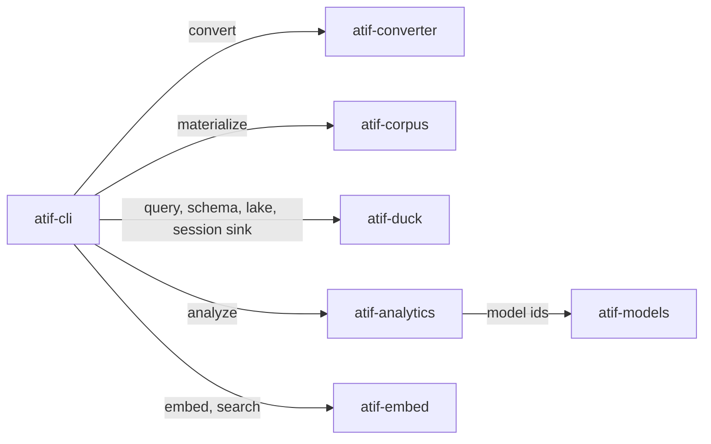

# atif-sql · System overview

## What it does

`atif-sql` is a command-line analytics tool over agent trajectories from Claude Code and Codex CLI. It reads the
session transcripts Claude Code leaves at `~/.claude/projects/**/*.jsonl` and the rollouts Codex CLI
leaves at `~/.codex/sessions/<YYYY>/<MM>/<DD>/rollout-*.jsonl`, converts each one to
ATIF (Harbor's Agent Trajectory Interchange Format), materializes the results as an on-disk
corpus, and answers SQL against that corpus through DuckDB (`README.md:13-17`). The design bet is
stated in the README itself: converting once at the boundary, with an explicit and tested fidelity
policy for what the upstream converter drops, beats re-deriving trajectory semantics inside every
SQL view (`README.md:17-19`). Which agent a command works on is one flag, `--agent claude-code|codex`, and it
moves the default source and corpus roots with it
(`packages/atif-corpus/src/atif_corpus/infrastructure/settings.py`); one corpus holds one agent, and
the `sessions` view reports which (`packages/atif-duck/src/atif_duck/infrastructure/registry.py:1040`).
The reader it serves is an engineer or an agent asking how sessions
actually went: which tools ran, where tokens went, where a session turned into friction.

Users get one installable distribution and one console script,
`atif-sql = "atif_cli.app:main"` (`pyproject.toml:75`), installed with
`uv tool install atif-sql` (`README.md:29`). The command surface is the commands registered
with `@app.command` in `packages/atif-cli/src/atif_cli/app.py` plus the `cron`, `lake`, and
`corpus` sub-apps attached at `:104-109`. Nothing here is a server; DuckDB is embedded
(`packages/atif-duck/pyproject.toml:20`), as are the SQLite analytics state file and the LanceDB
vector store. The commands `analyze` / `embed` / `search` call Amazon Bedrock and spend money
per invocation (`embed` and `search` run on this machine instead under
`ATIF_SQL_EMBED_PROVIDER=gemma`): `analyze` is a dry run by default, `embed` refuses to run without
`--limit` or `--all`, and `search` embeds one query per call (`README.md:50-54`).

## How the pieces fit

The directories under `packages/` are internal module boundaries, not separate installs
(`README.md:101`); they are uv workspace members (`pyproject.toml:111`). `atif-converter` owns the
conversion itself: its converters ported from Harbor under Apache-2.0 and held to parity with Harbor
0.24.0
(`packages/atif-converter/src/atif_converter/domain/claude_code_conversion.py`,
`packages/atif-converter/src/atif_converter/domain/codex_conversion.py`), built on Harbor's ATIF
data classes and validator, vendored in `packages/atif-converter/src/atif_converter/domain/atif/`. harbor itself is a dev dependency:
its private converters survive only as the parity oracle in the converter's tests
(`packages/atif-converter/tests/harbor_oracle.py:3`), and `packages/atif-converter/tests/test_vendored_atif.py` holds the vendored
copy to upstream. It also
owns the fidelity policy as types: `FidelityGap` enumerates the
known upstream conversion gaps
(`packages/atif-converter/src/atif_converter/domain/fidelity.py:55`), and `CodexFidelityGap`
enumerates the ones that are Codex's
(`packages/atif-converter/src/atif_converter/domain/codex_fidelity.py:66`). `atif-corpus`
drives materialization, writing per-session artifacts plus a corpus watermark
(`docs/CONTRACT.md:22`). Its `ConverterPort` Protocol lets an implementation raise anything: the
materialize use case records the failure against that session and continues, so one broken
transcript never aborts a sync (`packages/atif-corpus/src/atif_corpus/domain/ports.py:104-106`).

`atif-duck` reads the corpus root and never imports the packages that wrote it
(`docs/CONTRACT.md:247`). Its `register` entry point registers raw readers, views, vector search,
macros, the authorship views, and the analytics surface in that order, because views bind against
the raw TEMP tables at CREATE time
(`packages/atif-duck/src/atif_duck/infrastructure/registry.py:2095`); the per-session raw readers
are `CREATE TEMP TABLE` over `read_json` (`:15`), and every view and macro name is declared in a
static catalog (`packages/atif-duck/src/atif_duck/domain/catalog.py:30`). `atif-analytics` writes
parquet plus one SQLite WAL `state.db` under
`<corpus_root>/analytics/` (`packages/atif-analytics/src/atif_analytics/domain/layout.py:6`).
`atif-embed` backfills Cohere Embed v4 vectors, or EmbeddingGemma 2 vectors computed on this
machine, into LanceDB (`packages/atif-embed/pyproject.toml:4`), which `atif-duck` reads back through DuckDB's lance
extension rather than by importing lancedb
(`packages/atif-duck/src/atif_duck/infrastructure/registry.py:1621-1624`). `atif-models` is the single
owner of model ids, so no other package hardcodes one (`packages/atif-models/pyproject.toml:4`).

Every corpus is also loaded into one DuckLake, kept at `ATIF_SQL_LAKE_ROOT` beside the corpora.
The per-session artifacts stay the source of truth, stored once: materialize writes each session's
trajectory, edges and events zstd-compressed and no per-session parquet, and the lake holds the
queryable rows. The lake tables are the raw reader shapes with
`corpus`, `agent` and `session_id` in front
(`packages/atif-duck/src/atif_duck/domain/lake.py`), loaded from the same raw relations `query`
would otherwise build. `atif-corpus` declares the `SessionSink` port that materialize hands every
published session to, after the swaps and in the parent process only
(`packages/atif-corpus/src/atif_corpus/domain/ports.py`); `atif-duck` implements it as
`DuckLakeSessionSink` and `atif-cli` wires the two together, as it does for the converter. The
sink loads a session by decoding its trajectory in Python and staging typed parquet outside the
corpus, which keeps the writer inside its memory cap. The
reader side attaches a published read-only copy of the lake catalog and binds the raw relations as
views over the lake, falling back to the per-session artifacts when the lake is absent, stale, or
doesn't hold the corpus (`packages/atif-duck/src/atif_duck/infrastructure/lake.py`).

The direction of those edges is enforced rather than conventional. `[tool.importlinter]`
(`pyproject.toml:547`) declares a layers contract for every member except `atif-cli` and
`atif-duck`, an independence contract forbidding converter / corpus / duck / models / embed from
importing each other (`:600`), and a forbidden contract limiting `atif-analytics` to `atif-models`
alone among the members (`:605`). `atif-cli` is
the sole composition root, and it imports its siblings lazily inside command bodies
(`packages/atif-cli/src/atif_cli/app.py:712`, `:1697`, `:1903`) so that `atif-sql schema` pays for
none of the analytics or vector stack. Failures surface as typed exceptions mapped to stable
process exit codes at the CLI edge (`packages/atif-cli/src/atif_cli/errors.py:30`).

## Stack

| Layer | Technology | Source |
| --- | --- | --- |
| Language | Python, `requires-python = ">=3.13"` | `packages/atif-cli/pyproject.toml:14` |
| Toolchain pin | mise, `python = "3.13"` | `mise.toml:32` |
| Packaging | uv workspace, `members = ["packages/*"]` | `pyproject.toml:111` |
| Build backend | `hatchling>=1.28.0` for the published wheel, `uv_build>=0.11.14,<0.13` for the member manifests | `pyproject.toml:90`, `packages/atif-cli/pyproject.toml:53` |
| CLI framework | `cyclopts>=5.1.1` | `packages/atif-cli/pyproject.toml:37` |
| Query engine | `duckdb>=2.0.0,<3` | `packages/atif-duck/pyproject.toml:20` |
| Lake | DuckLake, through DuckDB's `ducklake` extension, with a DuckDB-file catalog | `packages/atif-duck/src/atif_duck/infrastructure/lake.py` |
| Trajectory models | vendored from harbor 0.24.0 (`pydantic>=2.13.2`) | `packages/atif-converter/src/atif_converter/domain/atif/__init__.py` |
| Vector store | `lancedb>=0.30,<0.40` | `packages/atif-embed/pyproject.toml:22` |
| Model access | `boto3>=1.42.91` for Bedrock | `packages/atif-models/pyproject.toml:28` |
| Dataframes | `polars>=1.40.0` | `packages/atif-embed/pyproject.toml:24` |
| Validation | `pydantic>=2.13.2` | `packages/atif-converter/pyproject.toml:23` |
| Logging | `loguru>=0.7.3` | `packages/atif-corpus/pyproject.toml:19` |
| Lint and format | ruff, `select = ["ALL"]` | `pyproject.toml:206` |
| Architecture gate | import-linter contracts | `pyproject.toml:547` |
| Tests | pytest, `testpaths = ["packages/*/tests", "fuzz"]` | `pyproject.toml:474` |
| Definition of done | `mise run check` | `mise.toml:243` |

## Module map

Nodes are the uv workspace members. Every edge is an import confirmed at an import site.
There is no `atif-corpus` to `atif-converter` edge: the independence contract forbids it, and
`RealConverter` in `packages/atif-cli/src/atif_cli/converter_adapter.py:80` satisfies
`ConverterPort` by importing both from the composition root (`:64`, `:69`). `atif-duck`,
`atif-analytics`, and `atif-embed` exchange data through corpus files on disk, never through an
import.

## See also

- [contract map](../insights/contract-map.md)
- [dependency graph](../diagrams/structural/dependency-graph.md)
- [impact analysis](../insights/impact-analysis.md)
- [module map](module-map.md)
- [processes](../behavior/processes.md)
