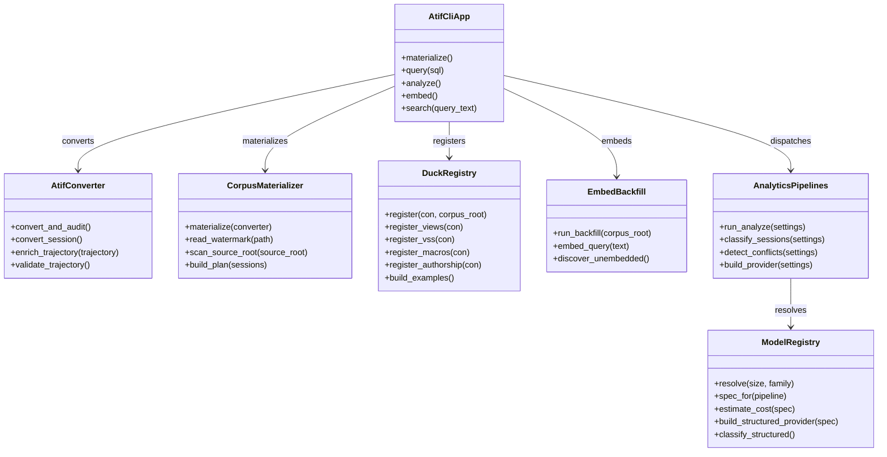

# atif-sql · Components

## Legend

### Classes

Each node is one uv workspace member, the unit the import-linter contracts
at `pyproject.toml:554-615` constrain. Every use case and registration entry point
is a module-level function, so the `+` entries are functions rather than methods, apart from two
in `ModelRegistry`: `spec_for` is a method of `LlmSettings`, and `classify_structured` is a Protocol
method.
`AtifCliApp`'s entries each carry an `@app.command` decorator on the line
above; `app` is the `cyclopts.App` at `packages/atif-cli/src/atif_cli/app.py:90`
and `main` at `packages/atif-cli/src/atif_cli/app.py:2431` is the `atif-sql`
console script declared at `pyproject.toml:75`.

| Class | Workspace member | Method entry | Declared at |
| --- | --- | --- | --- |
| `AtifCliApp` | atif-cli | `materialize` | `packages/atif-cli/src/atif_cli/app.py:878` |
| `AtifCliApp` | atif-cli | `query` | `packages/atif-cli/src/atif_cli/app.py:1320` |
| `AtifCliApp` | atif-cli | `analyze` | `packages/atif-cli/src/atif_cli/app.py:1656` |
| `AtifCliApp` | atif-cli | `embed` | `packages/atif-cli/src/atif_cli/app.py:1823` |
| `AtifCliApp` | atif-cli | `search` | `packages/atif-cli/src/atif_cli/app.py:2040` |
| `AtifConverter` | atif-converter | `convert_and_audit` | `packages/atif-converter/src/atif_converter/application/convert_and_audit.py:220` |
| `AtifConverter` | atif-converter | `convert_session` | `packages/atif-converter/src/atif_converter/infrastructure/harbor_adapter.py:157` |
| `AtifConverter` | atif-converter | `enrich_trajectory` | `packages/atif-converter/src/atif_converter/domain/enrichment.py:198` |
| `AtifConverter` | atif-converter | `validate_trajectory` | `packages/atif-converter/src/atif_converter/infrastructure/harbor_adapter.py:76` |
| `CorpusMaterializer` | atif-corpus | `materialize` | `packages/atif-corpus/src/atif_corpus/application/materialize.py:1497` |
| `CorpusMaterializer` | atif-corpus | `read_watermark` | `packages/atif-corpus/src/atif_corpus/application/materialize.py:424` |
| `CorpusMaterializer` | atif-corpus | `scan_source_root` | `packages/atif-corpus/src/atif_corpus/infrastructure/scanner.py:302` |
| `CorpusMaterializer` | atif-corpus | `build_plan` | `packages/atif-corpus/src/atif_corpus/domain/sessions.py:169` |
| `DuckRegistry` | atif-duck | `register` | `packages/atif-duck/src/atif_duck/infrastructure/registry.py:2129` |
| `DuckRegistry` | atif-duck | `register_views` | `packages/atif-duck/src/atif_duck/infrastructure/registry.py:1018` |
| `DuckRegistry` | atif-duck | `register_vss` | `packages/atif-duck/src/atif_duck/infrastructure/registry.py:1635` |
| `DuckRegistry` | atif-duck | `register_macros` | `packages/atif-duck/src/atif_duck/infrastructure/registry.py:1890` |
| `DuckRegistry` | atif-duck | `register_authorship` | `packages/atif-duck/src/atif_duck/infrastructure/authorship.py:38` |
| `DuckRegistry` | atif-duck | `build_examples` | `packages/atif-duck/src/atif_duck/domain/examples.py:191` |
| `EmbedBackfill` | atif-embed | `run_backfill` | `packages/atif-embed/src/atif_embed/application/embed.py:61` |
| `EmbedBackfill` | atif-embed | `embed_query` | `packages/atif-embed/src/atif_embed/application/embed.py:280` |
| `EmbedBackfill` | atif-embed | `discover_unembedded` | `packages/atif-embed/src/atif_embed/application/embed.py:43` |
| `AnalyticsPipelines` | atif-analytics | `run_analyze` | `packages/atif-analytics/src/atif_analytics/application/analyze.py:37` |
| `AnalyticsPipelines` | atif-analytics | `classify_sessions` | `packages/atif-analytics/src/atif_analytics/application/use_cases/classify.py:374` |
| `AnalyticsPipelines` | atif-analytics | `detect_conflicts` | `packages/atif-analytics/src/atif_analytics/application/use_cases/conflicts.py:354` |
| `AnalyticsPipelines` | atif-analytics | `build_provider` | `packages/atif-analytics/src/atif_analytics/application/use_cases/_shared.py:36` |
| `ModelRegistry` | atif-models | `resolve` | `packages/atif-models/src/atif_models/domain/registry.py:162` |
| `ModelRegistry` | atif-models | `spec_for` | `packages/atif-models/src/atif_models/infrastructure/settings.py:80` |
| `ModelRegistry` | atif-models | `estimate_cost` | `packages/atif-models/src/atif_models/domain/registry.py:180` |
| `ModelRegistry` | atif-models | `build_structured_provider` | `packages/atif-models/src/atif_models/infrastructure/providers.py:20` |
| `ModelRegistry` | atif-models | `classify_structured` | `packages/atif-models/src/atif_models/domain/ports.py:138`, the sole method of the `LlmStructuredProvider` Protocol at `packages/atif-models/src/atif_models/domain/ports.py:131`, implemented by `OpenAiBedrockProvider` at `packages/atif-models/src/atif_models/infrastructure/openai_bedrock.py:149` and by `AnthropicBedrockProvider` at `packages/atif-models/src/atif_models/infrastructure/anthropic_bedrock.py:185` |

`register` calls the other registrars, then the analytics registrars, in
binding order at
`packages/atif-duck/src/atif_duck/infrastructure/registry.py:2206-2227`;
`run_analyze` dispatches the LLM stages from a table at
`packages/atif-analytics/src/atif_analytics/application/analyze.py:103-108`.

### Relationships

Every edge is one import plus one call. **Every cross-package import in `atif_cli.app`
and in atif-analytics is indented into the function body that needs it**, never at module top.
A fresh-interpreter test asserts that a bare `import atif_cli.app` pulls in none
of `duckdb`, `harbor`, `lancedb`, `boto3`, or `polars`
(`_FORBIDDEN_EAGER_IMPORTS` at `packages/atif-cli/tests/test_lean_import.py:17-38`),
and `packages/atif-cli/src/atif_cli/app.py:50-53` records that as the reason the
heavy imports sit in the command bodies. A line-anchored grep for `^from atif_`
therefore finds none of these edges. It does hit the atif-cli helper modules that `atif_cli.app`
imports inside its function bodies (`converter_adapter`, `duck_errors`, `lake_sessions`,
`embed_lake`), which import their siblings at module top.

Most edges originate at `AtifCliApp`, which
`packages/atif-cli/src/atif_cli/app.py:3-7` names the workspace's composition
root. Those edges are the whole of its outbound surface: an unanchored grep for
`from atif_(converter|corpus|duck|models|embed|analytics)` across
`packages/atif-cli/src` returns hits spanning exactly those members, and
**atif-cli never imports atif-models**.

| Edge | Verb | Import site | Call site |
| --- | --- | --- | --- |
| `AtifCliApp -> AtifConverter` | converts | `packages/atif-cli/src/atif_cli/app.py:727` | `packages/atif-cli/src/atif_cli/app.py:741` |
| `AtifCliApp -> CorpusMaterializer` | materializes | `packages/atif-cli/src/atif_cli/app.py:946` | `packages/atif-cli/src/atif_cli/app.py:973` |
| `AtifCliApp -> DuckRegistry` | registers | `packages/atif-cli/src/atif_cli/app.py:1478`, `packages/atif-cli/src/atif_cli/app.py:2108` | `packages/atif-cli/src/atif_cli/app.py:1505`, `packages/atif-cli/src/atif_cli/app.py:2138` |
| `AtifCliApp -> AnalyticsPipelines` | dispatches | `packages/atif-cli/src/atif_cli/app.py:1719` | `packages/atif-cli/src/atif_cli/app.py:1740` |
| `AtifCliApp -> EmbedBackfill` | embeds | `packages/atif-cli/src/atif_cli/app.py:1925` | `packages/atif-cli/src/atif_cli/app.py:1959` |
| `AnalyticsPipelines -> ModelRegistry` | resolves | `packages/atif-analytics/src/atif_analytics/application/use_cases/_shared.py:46` | `packages/atif-analytics/src/atif_analytics/application/use_cases/_shared.py:49`, `packages/atif-analytics/src/atif_analytics/application/use_cases/_shared.py:50` |

### Relationships the import contracts forbid

`pyproject.toml:606-609` declares an `independence` contract over
`atif_converter`, `atif_corpus`, `atif_duck`, `atif_models`, and `atif_embed`, so
no edge may connect any two of them. `pyproject.toml:611-615` declares a
`forbidden` contract admitting exactly one analytics edge, to `atif_models`. Both
are checked by `lint:imports`, one of the gates `mise run check`
depends on (`mise.toml:250`, in the list at `mise.toml:245-265`).

A Protocol declared in one member and implemented in another is **not** an edge
between them: the implementation satisfies it structurally, and the composition
root supplies the instance. Neither is a permission comment an edge: the comment at
`pyproject.toml:601-605` leaves atif-cli and atif-analytics free to import
atif-models, a reach atif-cli doesn't take.

| Absent edge | How the same work reaches across the boundary |
| --- | --- |
| `CorpusMaterializer -> AtifConverter` | `materialize` takes a `ConverterPort` parameter (`packages/atif-corpus/src/atif_corpus/application/materialize.py:1501`), the Protocol at `packages/atif-corpus/src/atif_corpus/domain/ports.py:101`. `AtifCliApp` constructs the `RealConverter` adapter (`packages/atif-cli/src/atif_cli/converter_adapter.py:80`) and injects it at `packages/atif-cli/src/atif_cli/app.py:976`; that adapter's docstring names the independence contract as its reason to live in atif-cli (`packages/atif-cli/src/atif_cli/converter_adapter.py:5-9`). |
| `EmbedBackfill -> DuckRegistry` | `EmbedBackfill` reads the corpus through its own DuckDB `TextRowsPort` adapter, `DuckDbTextRows` (`packages/atif-embed/src/atif_embed/infrastructure/corpus_text_rows.py:229`) against the Protocol at `packages/atif-embed/src/atif_embed/domain/ports.py:93`, over the `docs/CONTRACT.md` corpus layout (stated at `pyproject.toml:550-552`). With the lake on, the default, `AtifCliApp` wraps that adapter in `LakeTextRows` (`packages/atif-embed/src/atif_embed/infrastructure/lake_text_rows.py:89`), which reads the lake through the `LakeStepsPort` Protocol (`packages/atif-embed/src/atif_embed/domain/ports.py:202`) that atif-cli implements over atif-duck (`packages/atif-cli/src/atif_cli/embed_lake.py:70`). |
| `AnalyticsPipelines -> CorpusMaterializer` | `AnalyticsPipelines` reads the materialized corpus directly through its own `CorpusReader` (`packages/atif-analytics/src/atif_analytics/infrastructure/corpus_reader.py:314`), constructed once per run at `packages/atif-analytics/src/atif_analytics/application/analyze.py:62`. With the lake on, the default, `AtifCliApp` hands that reader a `SessionSource` over the lake, `LakeSessionSource` (`packages/atif-cli/src/atif_cli/lake_sessions.py:92`), which atif-cli adapts from atif-duck's lake reader. |
| `AtifCliApp -> ModelRegistry` | `AtifCliApp` never reaches atif-models. Model selection happens inside `AnalyticsPipelines`, whose `build_provider` resolves a spec through `spec_for` (`packages/atif-analytics/src/atif_analytics/application/use_cases/_shared.py:49`) and hands it to `build_structured_provider` (`packages/atif-analytics/src/atif_analytics/application/use_cases/_shared.py:50`), so no model id is written down outside atif-models. |

## See also

- [module map](../../architecture/module-map.md)
- [processes](../../behavior/processes.md)
- [impact analysis](../../insights/impact-analysis.md)
- [contract map](../../insights/contract-map.md)
- [business logic](../../insights/business-logic.md)
