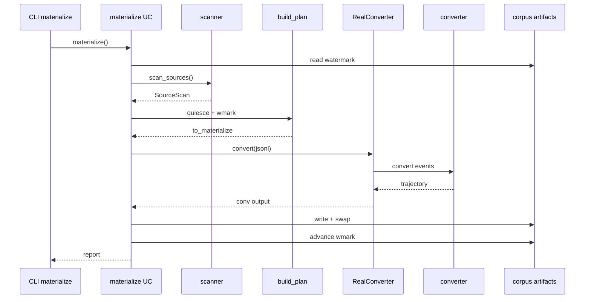
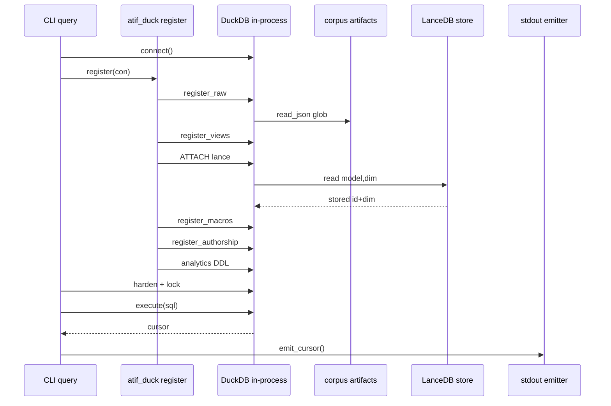
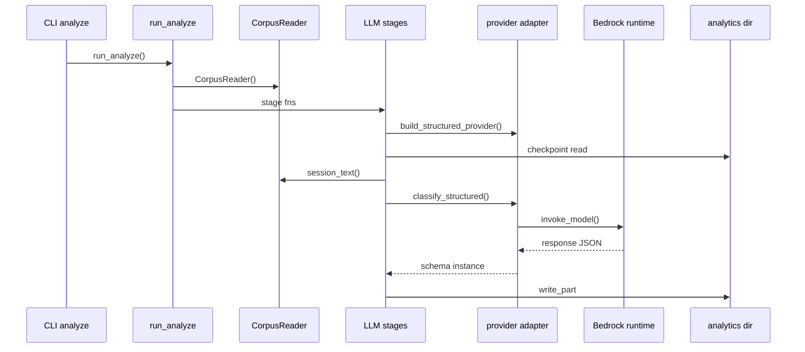

# atif-sql · Sequences

## materialize

Sources, in dispatch order:

- CLI materialize: `packages/atif-cli/src/atif_cli/app.py:878`; report rendered at `:1042`.
- materialize UC: `packages/atif-corpus/src/atif_corpus/application/materialize.py:1497`;
  `read_watermark` at `:424` called from `:1620`, `scan_sources` called at `:1622`, `build_plan` called
  at `:1696`, `_write_session` at `:612` called from `:777`, watermark advanced at `:1776-1779`, report
  built at `:1791`.
- scanner: `packages/atif-corpus/src/atif_corpus/infrastructure/scanner.py:206`.
- build_plan: `packages/atif-corpus/src/atif_corpus/domain/sessions.py:169`.
- RealConverter: `packages/atif-cli/src/atif_cli/converter_adapter.py:80`, calling
  `packages/atif-converter/src/atif_converter/application/convert_and_audit.py:220`.
- converter: our ported Claude Code converter,
  `packages/atif-converter/src/atif_converter/domain/claude_code_conversion.py:981`, reached from the
  seam at `packages/atif-converter/src/atif_converter/infrastructure/harbor_adapter.py:128`; the ATIF
  data classes and the validator the seam checks with (`:76`) are harbor's, vendored under
  `atif_converter.domain.atif`.
- corpus artifacts: path arithmetic in
  `packages/atif-corpus/src/atif_corpus/domain/layout.py:65`; the artifacts written and the
  directory swapped at `packages/atif-corpus/src/atif_corpus/application/materialize.py:691-733`
  through `write_json_atomic` (`packages/atif-corpus/src/atif_corpus/infrastructure/atomic.py:72`),
  its zstd siblings (`:142`, `:159`), and `replace_dir_atomic` (`:165`).

## query

Sources, in dispatch order:

- CLI query: `packages/atif-cli/src/atif_cli/app.py:1320`; `duckdb.connect()` at `:1495`, the lake
  attached at `:1501` when it holds the corpus, `register` called at `:1505`,
  `_harden_query_connection` at `:537` called from `:1514`, caller SQL executed at `:1536`, emit at
  `:1542`.
- atif_duck register: `packages/atif-duck/src/atif_duck/infrastructure/registry.py:2129`, whose
  documented order is fixed at `:2150-2158`: `register_raw` `:631` (`register_lake_raw` instead when
  the lake is attached), `register_views` `:1018`, `register_vss` `:1635`, `register_macros` `:1890`,
  then the authorship surface and the analytics pair.
- DuckDB in-process: the connection opened by the CLI; the sandbox settings and
  `lock_configuration` are issued against it at `packages/atif-cli/src/atif_cli/app.py:597-606`.
- corpus artifacts: on the per-session path, session globs read through `read_json` at
  `packages/atif-duck/src/atif_duck/infrastructure/registry.py:749-764`; the analytics parquets bind
  through `packages/atif-duck/src/atif_duck/infrastructure/analytics.py:119`, with the analytics
  macros at `:236`.
- LanceDB store: reached through DuckDB's lance extension;
  `packages/atif-duck/src/atif_duck/infrastructure/registry.py:1697-1714` loads it and ATTACHes the
  store (installing it is `install_lance_extension` at `:1619`, behind `atif-sql embed`); the
  stamped `(model, dim)` identity is read at `:1746` and checked by
  `packages/atif-duck/src/atif_duck/domain/embedding_guard.py:51`.
- stdout emitter: `packages/atif-cli/src/atif_cli/output.py:158`; a registration failure routes
  through `packages/atif-cli/src/atif_cli/duck_errors.py:67` instead.

## analyze

Sources, in dispatch order:

- CLI analyze: `packages/atif-cli/src/atif_cli/app.py:1656`; settings resolved at `:1722-1729`,
  `run_analyze` called at `:1740`.
- run_analyze: `packages/atif-analytics/src/atif_analytics/application/analyze.py:37`; the
  `stages` list at `:103-108`, each stage invoked at `:129`.
- CorpusReader: `packages/atif-analytics/src/atif_analytics/infrastructure/corpus_reader.py:314`,
  constructed once per run at
  `packages/atif-analytics/src/atif_analytics/application/analyze.py:62`; `session_text` at
  `packages/atif-analytics/src/atif_analytics/infrastructure/corpus_reader.py:484`.
- LLM stages: the classify exemplar at
  `packages/atif-analytics/src/atif_analytics/application/use_cases/classify.py:374`; structured
  call dispatched at
  `packages/atif-analytics/src/atif_analytics/application/use_cases/classify.py:218`, its user
  message the fenced transcript and request line built by
  `packages/atif-analytics/src/atif_analytics/application/prompts.py:742`.
- provider adapter: built once per stage by
  `packages/atif-analytics/src/atif_analytics/application/use_cases/_shared.py:36` through
  `build_structured_provider` at
  `packages/atif-models/src/atif_models/infrastructure/providers.py:20`, which returns
  `OpenAiBedrockProvider` for the default `openai` family
  (`packages/atif-models/src/atif_models/infrastructure/openai_bedrock.py:81`;
  `classify_structured` at `:149`, response parsed into the schema instance at `:201`)
  and `AnthropicBedrockProvider` for `anthropic`
  (`packages/atif-models/src/atif_models/infrastructure/anthropic_bedrock.py:130`;
  `classify_structured` at `:185`, response parsed at `:239`).
- Bedrock runtime: blocking `invoke_model` at
  `packages/atif-models/src/atif_models/infrastructure/openai_bedrock.py:193` and
  `packages/atif-models/src/atif_models/infrastructure/anthropic_bedrock.py:231`, on the
  `bedrock-runtime` client both adapters build through
  `packages/atif-models/src/atif_models/infrastructure/bedrock_common.py:88`.
- analytics dir: `<corpus_root>/analytics/`, defined at
  `packages/atif-analytics/src/atif_analytics/domain/layout.py:51`, holding both the sharded parquet
  caches (`write_part`
  `packages/atif-analytics/src/atif_analytics/infrastructure/parquet_cache.py:90`, called at
  `packages/atif-analytics/src/atif_analytics/application/use_cases/classify.py:282`) and the single
  SQLite WAL `state.db`
  (`packages/atif-analytics/src/atif_analytics/domain/layout.py:81`).
- analytics dir, SQLite arm: `filter_unchanged`
  `packages/atif-analytics/src/atif_analytics/infrastructure/sqlite_state/checkpointer.py:137` called
  at `packages/atif-analytics/src/atif_analytics/application/use_cases/classify.py:115`;
  `mark_completed`
  `packages/atif-analytics/src/atif_analytics/infrastructure/sqlite_state/checkpointer.py:300` called
  at `packages/atif-analytics/src/atif_analytics/application/use_cases/classify.py:290`; retry drain
  `packages/atif-analytics/src/atif_analytics/infrastructure/sqlite_state/retry_queue.py:265` called
  at `packages/atif-analytics/src/atif_analytics/application/use_cases/classify.py:124`.

## See also

- [processes](../../behavior/processes.md)
- [debugging guide](../../insights/debugging-guide.md)
- [module map](../../architecture/module-map.md)
- [business logic](../../insights/business-logic.md)
- [data flow](../../architecture/data-flow.md)
