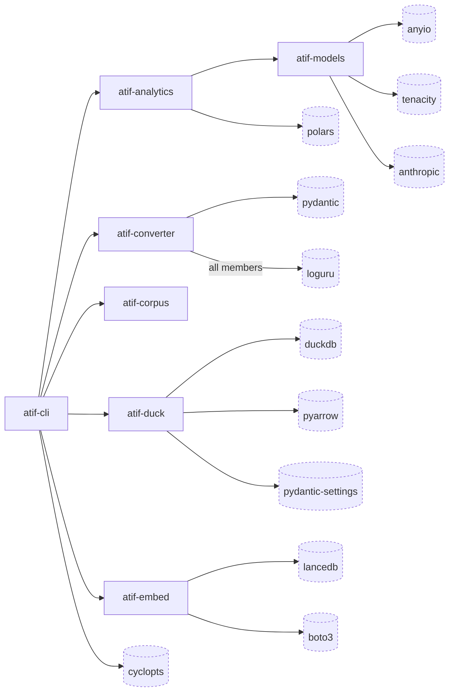

# atif-sql · Dependency graph

The internal modules and their highest-frequency external dependencies. Internal nodes are
the uv workspace members declared by `[tool.uv.workspace] members = ["packages/*"]`
(`pyproject.toml:110-111`); external nodes are first-order distributions taken from a member's own
`[project.dependencies]`, never from the installed transitive closure.

The internal direction is enforced rather than conventional. `pyproject.toml:550` declares
`[tool.importlinter]` over every root package (`:551`), and `mise run lint:imports`
(`mise.toml:172`) is one of the gates `mise run check` depends on (`mise.toml:245-265`). Some of
those contracts fix the shape drawn here: the `independence` contract at `pyproject.toml:602-605`
forbids any import edge among atif_converter, atif_corpus, atif_duck, atif_models, and atif_embed, and
the `forbidden` contract at `:607-611` allows atif_analytics to import atif_models and nothing else
among the members.

## Legend (overflow)

Some declared external distributions are left off the diagram. Importing modules are found by
grepping every `*.py` under `packages/*/src` for a `from X` or `import X` line at any indentation.

| elided node | importing module | declared at | import site |
| --- | --- | --- | --- |
| pytz | none | `packages/atif-duck/pyproject.toml:33` | no import site; DuckDB's own client imports it to materialize TIMESTAMPTZ, per the comment at `:30-32` |
| `zstandard` | atif-corpus most often; atif-analytics, atif-converter, atif-duck, and atif-embed too | `packages/atif-corpus/pyproject.toml:22` | `packages/atif-corpus/src/atif_corpus/infrastructure/source_archive.py:38` |
| `imagesize` | atif-converter | `packages/atif-converter/pyproject.toml:30` | `packages/atif-converter/src/atif_converter/domain/blobs.py:69` |

## Internal edges

These ordered pairs of members import each other, and no other pair does. Each edge is an import
from a file under the source member's `src/`.

| edge | contract that permits it |
| --- | --- |
| atif-cli to atif-analytics | atif-cli is the composition root; it is in neither restrictive contract's restricted set (`pyproject.toml:605`, `:610`) |
| atif-cli to atif-converter | as above; declared `packages/atif-cli/pyproject.toml:33` |
| atif-cli to atif-corpus | as above; declared `packages/atif-cli/pyproject.toml:34` |
| atif-cli to atif-duck | as above; declared `packages/atif-cli/pyproject.toml:35` |
| atif-cli to atif-embed | as above; declared `packages/atif-cli/pyproject.toml:36` |
| atif-analytics to atif-models | the `forbidden` contract's single permitted edge (`pyproject.toml:607-611`); declared `packages/atif-analytics/pyproject.toml:23` |

Absences carry meaning too. atif-cli imports atif_models in no source file even though it composes
everything else; it reaches the model registry through atif-analytics, and its
`[project.dependencies]` list omits atif-models accordingly (`packages/atif-cli/pyproject.toml:32-43`).
And no edge exists in either direction between atif-converter, atif-corpus, atif-duck, atif-embed, or
atif-models: they communicate only by writing and reading the corpus on disk. Adding any such edge
fails the `lint:imports` gate of `mise run check`.

The inter-member dependencies are `==0.3.0`-pinned rather than bare
(`packages/atif-cli/pyproject.toml:32-36`) because `[tool.uv.sources]` at `:60-65` is a local source an
external installer never sees; a bare name would ship as a `Requires-Dist` resolved from the public
PyPI namespace.

## External edges and where each is sourced

One edge per external distribution, drawn from the member whose files import it most often. Ties break
on import-site count, then on the member's own src line count, descending.

| external node | edge drawn from | declared at | import site |
| --- | --- | --- | --- |
| loguru | atif-converter | `packages/atif-converter/pyproject.toml:24` | `packages/atif-converter/src/atif_converter/domain/codex_conversion.py:70` |
| polars | atif-analytics | `packages/atif-analytics/pyproject.toml:25` | `packages/atif-analytics/src/atif_analytics/application/use_cases/classify.py:41` |
| pydantic | atif-converter | `packages/atif-converter/pyproject.toml:23` | `packages/atif-converter/src/atif_converter/domain/atif/trajectory.py:10` |
| duckdb | atif-duck | `packages/atif-duck/pyproject.toml:20` | `packages/atif-duck/src/atif_duck/infrastructure/registry.py:132` |
| pydantic-settings | atif-duck | `packages/atif-duck/pyproject.toml:25` | `packages/atif-duck/src/atif_duck/infrastructure/lake_settings.py:15` |
| tenacity | atif-models | `packages/atif-models/pyproject.toml:32` | `packages/atif-models/src/atif_models/infrastructure/openai_bedrock.py:34` |
| pyarrow | atif-duck | `packages/atif-duck/pyproject.toml:29` | `packages/atif-duck/src/atif_duck/infrastructure/columnar.py:287` |
| lancedb | atif-embed | `packages/atif-embed/pyproject.toml:22` | `packages/atif-embed/src/atif_embed/infrastructure/lance_store.py:42` |
| anyio | atif-models | `packages/atif-models/pyproject.toml:23` | `packages/atif-models/src/atif_models/infrastructure/openai_bedrock.py:30` |
| cyclopts | atif-cli | `packages/atif-cli/pyproject.toml:37` | `packages/atif-cli/src/atif_cli/app.py:69` |
| boto3 | atif-embed | `packages/atif-embed/pyproject.toml:20` | `packages/atif-embed/src/atif_embed/infrastructure/cohere_bedrock.py:136` |
| anthropic | atif-models | `packages/atif-models/pyproject.toml:22` | `packages/atif-models/src/atif_models/infrastructure/anthropic_bedrock.py:51` |

What the drawn edge deliberately compresses:

- **loguru is universal.** Every member declares it (`packages/atif-analytics/pyproject.toml:24`,
  `packages/atif-cli/pyproject.toml:43`, `packages/atif-converter/pyproject.toml:24`,
  `packages/atif-corpus/pyproject.toml:19`, `packages/atif-duck/pyproject.toml:21`,
  `packages/atif-embed/pyproject.toml:23`, `packages/atif-models/pyproject.toml:29`), and the edge is
  drawn from atif-converter only because more of the importing files are its than any other
  member's. The edge label states
  the real fan-out.
- **atif-corpus has no drawn external edge.** It declares its externals: loguru
  (`packages/atif-corpus/pyproject.toml:19`), pydantic (`:20`), pydantic-settings (`:21`), and
  `zstandard` (`:22`). Another member imports loguru and pydantic in more files, and atif-duck wins the
  pydantic-settings tie on src line count, so the attribution rule sources those three elsewhere. atif-corpus
  imports `zstandard` in more files than any other member, and `zstandard` is one of the nodes the legend
  leaves off the diagram. Its own import sites are real: `packages/atif-corpus/src/atif_corpus/infrastructure/settings.py:26`
  and `packages/atif-corpus/src/atif_corpus/domain/sessions.py:29`.
- **harbor is a dev dependency.** Production code builds on harbor 0.24.0's ATIF data classes
  and validator, vendored in `packages/atif-converter/src/atif_converter/domain/atif/`, and imports nothing from harbor itself.
  The conversions are ours: the Claude Code one is ported from harbor 0.24.0
  (`packages/atif-converter/src/atif_converter/domain/claude_code_conversion.py:2`), and the Codex one
  from 0.22.0, brought to 0.24.0
  (`packages/atif-converter/src/atif_converter/domain/codex_conversion.py:2-3`). An `ast` guard keeps
  `harbor` and `litellm` out of every `src/` tree (`packages/atif-converter/tests/test_dev_only_imports_guard.py`), and
  harbor's private converters are reachable from the parity oracle in the tests only
  (`packages/atif-converter/tests/harbor_oracle.py:43`).

## Declared dependencies are not the installed closure

The diagram's external nodes are what a member asks for, and that is a strictly smaller set than what
`uv sync` installs. The gap includes a web stack this system never runs: harbor, a dev-group
dependency (`pyproject.toml:160`), lists `fastapi`, `supabase`, and `uvicorn` in its own dependency
block, and `uv sync` installs the dev group by default. No member declares any of them, and
`grep -rnE "^[[:space:]]*(from|import) +(fastapi|uvicorn|starlette|supabase)(\.| |$)" --include='*.py' packages/`
returns no matches across every source and test file. atif-sql exposes no HTTP surface; it is one
console script, `atif-sql = "atif_cli.app:main"` (`pyproject.toml:75`), over a set of
libraries.

Every storage engine in the graph is embedded, so no server node belongs here either: duckdb runs
in-process (`packages/atif-duck/pyproject.toml:20`) and lancedb is a local vector store
(`packages/atif-embed/pyproject.toml:22`). The only edge that leaves the machine is boto3 to Amazon
Bedrock, from `packages/atif-embed/src/atif_embed/infrastructure/cohere_bedrock.py:136` and
`packages/atif-models/src/atif_models/infrastructure/bedrock_common.py:14`, where both atif-models
adapters build their client. The anthropic distribution adds no edge of its own: atif-models imports
only its `transform_schema`, a local schema mapping
(`packages/atif-models/src/atif_models/infrastructure/anthropic_bedrock.py:51`), and sends the Claude
calls through the same boto3 client.

## See also

- [module map](../../architecture/module-map.md)
- [processes](../../behavior/processes.md)
- [contract map](../../insights/contract-map.md)
- [impact analysis](../../insights/impact-analysis.md)
- [tech debt](../../insights/tech-debt.md)
